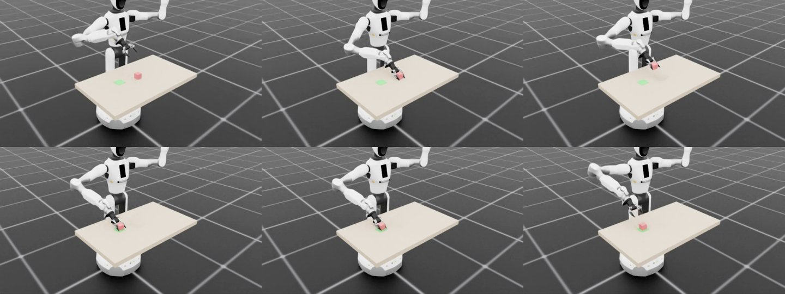

# 遥操作采集示教数据

:::{admonition} 学习目标
:class: lead-goals

- 把 lift 场景改成一个能录示范的 pick-place 环境：IK 动作、成功判定、Mimic 接口
- 写一个分段的示教控制器（scripted teacher），用它代替人手，录出与遥操作格式相同的示范
- 知道录完要检查什么，以及这些检查为什么影响 6.4.7
:::

:::{admonition} 前置知识
:class: lead-prereq

- [4.20 遥操作与设备](../../4-isaaclab/4.20-teleop-devices.md)：IK 相对动作、`record_demos.py` 的录制管线
- [4.19 Isaac Lab Mimic 与模仿学习](../../4-isaaclab/4.19-mimic.md)：Mimic 需要环境提供哪些接口
- [6.4.3 第二个任务：lift](6.4.3-lift.md)：方块、夹爪与抓取的物理
:::

**本页在项目中新增**：

- 任务包 `tasks/manager_based/pick_place/`：环境配置、修正版 IK 动作项、Mimic 环境类与配置，注册了 `Galbot-PickPlace-IK-Rel-v0` 和 `Galbot-PickPlace-IK-Rel-Mimic-v0`；
- `scripts/record_pick_place.py`（示教控制器 + 录制）、`scripts/check_mimic_interface.py`（Mimic 接口检查）、`scripts/replay_pick_place.py`（重放成视频）。

**本页的示范不是人手录的。** 本站没有人手遥操作的条件（[4.20](../../4-isaaclab/4.20-teleop-devices.md)），示范由一个写死的分段控制器产生。它输出的 7 维动作与键盘遥操作完全相同，录制管线也照搬 `record_demos.py`，所以文件格式与人手录的一样。换成真人操作，只需把控制器换成设备的 `advance()`。

:::{admonition} 官方自带：Galbot One Charlie 的 stack 环境
:class: note

Isaac Lab 2.3.2 已经带了 Galbot 的堆方块任务（`Isaac-Stack-Cube-Galbot-Left-Arm-Gripper-RmpFlow-v0` 等 5 个）及其 Mimic 版本（`Isaac-Stack-Cube-Galbot-Left-Arm-Gripper-RmpFlow-Rel-Mimic-v0` 等 4 个）[^official]。与本页的差别：那是 **One Charlie** 型号，资产来自 Nucleus；动作用 RmpFlow 控制器。本页用的是主线的 **One Golf**，资产由 GitHub 上的 URDF 转换（6.1.2），动作用 IK 动作项。写 Mimic 接口时本页对照了官方 Galbot 版的写法。
:::

## pick-place 环境

在 lift 的场景上加一块 8 cm × 8 cm 的绿色放置垫，放在方块右侧约 20 cm。每次重置，方块与放置垫的位置都在小范围内随机。

| 项 | 本页的选择 | 理由 |
|---|---|---|
| 动作 | 右臂 IK 相对动作（6 维，`scale=1.0`）+ 二值夹爪（1 维） | 与键盘遥操作的 7 维命令一致（4.20） |
| 跟踪点 | TCP：`right_arm_link7` 加 6.2.1 的固定偏移 | 与 FrameTransformer `ee_frame` 是同一个点（[6.2.2](../2-scene/6.2.2-wrist-camera.md)） |
| 观测 | 不拼接，按名字给出 `eef_pos`、`eef_quat`、`object_position`、`target_position`、`gripper_pos` 等 | Mimic 按名字读末端位姿 |
| 子任务信号 | `grasp`：夹爪测量位置 ≥ 1.0 rad，且方块中心离 TCP ≤ 3 cm | 只看夹爪会把空手握拳算进去；只看距离会把张着手经过算进去 |
| 成功判定 `success` | 方块中心离垫中心 ≤ 3 cm、高度误差 ≤ 1 cm、夹爪 ≤ 0.8 rad、TCP 离方块 ≥ 6 cm | 必须真的放下、松手、移开 |
| 机器人重力 | 关闭 | 见坑二 |

*表 1：`Galbot-PickPlace-IK-Rel-v0` 的设计（`pick_place_env_cfg.py`）。放置垫是运动学刚体、不参与碰撞，这样 Mimic 的 `get_object_poses` 能读到它的位姿。*

`scale` 取 1.0 而不是官方 Franka 的 0.5，原因在 Mimic 那边：`target_eef_pose_to_action` 直接把"目标 − 当前"当作动作，scale 不为 1，算出的动作就和动作项实际执行的增量差一个倍数。

**Mimic 接口**：`mimic_env.py` 实现了 4.19 列出的方法。所有位姿都在机器人根坐标系下：末端读观测里的 `eef_pos` / `eef_quat`，物体也换算到根坐标系。官方 Galbot 版同样把物体换到底座坐标系，因为那台 One Charlie 的根不在环境原点。子任务分两段（`mimic_env_cfg.py`）：先以方块为参考，到 `grasp` 为止；再以放置垫为参考，到示范结束。

## 抓取姿态

先要定手以什么姿态抓。夹爪的接近方向是 TCP 的 x 轴，两指沿 TCP 的 y 轴合拢（实测左右两个手指连杆的原点之差在 TCP 坐标系里是 [0, 0.131, 0] m）。第一反应是从正上方抓：接近方向竖直向下。但右臂的腕关节范围很窄（j6 约 ±0.8 rad，j7 ±1.54 rad），从上往下抓够不着。

为此扫了一遍：接近方向从竖直向下往前倾 θ = 0°–90°，朝向 φ ∈ {−45°, 0°, 45°}，闭合轴取两个方向，共 42 种姿态。每种先移到方块前上方的预抓点（pre-grasp pose），再降到方块中心，记位置误差、姿态误差和关节离限位的最小余量。

| θ（偏离竖直） | φ = 0°、闭合轴沿根 −y 时的结果 |
|---|---|
| 0°（正上方） | 姿态差 0.26 rad 收不拢，j7 顶在限位，方块被推开 3.4 cm |
| 30° | 到位（0.7 cm、0.022 rad），但 j7 余量为 0 |
| 60° | 到位（0.5 cm、0.003 rad），关节余量 ≥ 0.19 rad，方块几乎不动（0.1 cm） |
| 75° | 预抓点 1.0 cm，抓取点 2.0 cm，余量 ≥ 0.41 rad |

*表 2：抓取姿态扫描节选（`scripts/sweep_grasp_pose.py`，2026-10-11 实测；φ = ±45° 的几组也能到位，但闭合轴斜对方块的棱，不用）。*

本页取 **θ = 60°**：手从前上方斜着伸向方块，两指夹在方块左右两个侧面上。

## 示教控制器

`record_pick_place.py` 里的 `PickPlaceTeacher` 是一个按段推进的状态机（state machine）。每一步读观测，算出"朝本段目标点走一小步"的 IK 相对动作：位置每轴每步最多 1 cm（三轴合起来最多 1.73 cm），姿态每步最多 0.05 rad。整个过程都把 TCP 拉向表 2 选定的姿态。

| 段 | 目标点（TCP） | 夹爪 | 结束条件 |
|---|---|---|---|
| hover | 方块中心沿接近方向后退 12 cm、再抬高 12 cm | 开 | 误差 < 2 cm |
| pre | 后退 10 cm 的预抓点 | 开 | 误差 < 1 cm |
| approach | 进入本段时方块中心的位置（冻结，不追） | 开 | 误差 < 0.6 cm |
| close | 原地 | 合 | 夹爪位置 ≥ 1.0 rad 且连续 5 步不再变化 |
| lift | 上抬 10 cm | 合 | 误差 < 1 cm |
| carry | 方块中心到放置垫上方 10 cm | 合 | 误差 < 0.8 cm |
| lower | 方块中心到放置垫上、离桌面 3 mm | 合 | 误差 < 0.4 cm |
| open | 原地 | 开 | 夹爪位置 ≤ 0.75 rad |
| retreat | 沿接近方向后退 10 cm、抬高 5 cm | 开 | 误差 < 1 cm |

*表 3：示教控制器的分段。除 close、open 外，误差 30 步不再变小且 < 2 cm 时也算到达（IK 有 0.5–2 cm 的残差）；每段有步数上限，超过就判这次失败、丢弃重来。*

有三处是从失败里改出来的：

- **先到斜上方再下来（hover）**：直接从默认姿态去预抓点，手会扫到方块，把它推开十几厘米；
- **approach 冻结目标**：如果目标跟着方块走，手一碰到方块就会推着它跑；
- **carry 段给足 400 步**：最初给 240 步时，20 次尝试里有 4 次在 carry 段超时，剩余误差只有 0.8–5.7 cm。carry 走得慢：相对动作每步的目标只在当前位置前方 1–1.7 cm，实测每步实际只走约 0.1 cm（6.4.6 调试记录），关节 PD 跟上的只是其中一小部分（推断）。

**成功率**（每次尝试的方块与放置垫位置都重新随机）：最终版本连续 20 次尝试 20 次成功；正式录制的 10 次尝试 10 次成功。卡片要求 ≥ 90%，达标。

## 录制

```bash
python scripts/record_pick_place.py --headless --num_demos 10 --dataset_file ./datasets/galbot_pick_place.hdf5
```

录制部分逐条照搬 `record_demos.py`：1 个环境；把 `success` 项取出来在主循环里判断，连续 10 步成功才导出；关掉超时；只导出成功的回合；失败的这一条用 `handle_reset` 丢弃。与 `record_demos.py` 只有一处不同：不限速。限速是为了人能跟得上，脚本不需要，录下的数据也与限速无关。

实测（2026-10-11，RTX 5070）：10 次尝试，10 条示范，墙上 248 s，进程显存 2401 MiB，主机内存 3.7 GB，文件 3.2 MB。HDF5 结构与 [4.20](../../4-isaaclab/4.20-teleop-devices.md) 表 3 相同，`obs/` 下是表 1 的 8 项观测。

**看一眼**：`scripts/tools/hdf5_to_mp4.py` 只转换数据集里存下的相机图像（4.19"数据格式"），这里录的是状态，没有图像。所以改用 `replay_pick_place.py`：从初始状态开环重放动作，用视口相机逐步渲染成 MP4。



*图 1：`demo_0` 的六个时刻（从左到右、从上到下：第 60、132、260、420、470、510 步）。依次是到达预抓点、夹住、举起并搬运、放到绿色垫上、松开、后撤。由 `replay_pick_place.py --enable_cameras --width 640` 渲染：用时 44 s，进程显存 4646 MiB，主机内存 7.1 GB。1280 宽时主机内存超出保护线，被停掉。*

**Mimic 接口检查**：`check_mimic_interface.py` 在 `Galbot-PickPlace-IK-Rel-Mimic-v0` 里把 10 条示范逐条开环重放，做法与 `annotate_demos.py` 的自动标注相同。结果：

- 动作 → 目标位姿 → 动作的往返最大差 7.5 × 10⁻⁸；
- `get_object_poses` 返回方块与放置垫；
- 每条都在第 132 步触发 `grasp`；
- 重放结束时 10 / 10 仍满足 `success`。

## 质量检查

录完先看这几项，它们直接影响 [6.4.7](6.4.7-mimic.md) 能生成什么、学到什么：

| 检查项 | 本页的 10 条 | 为什么重要 |
|---|---|---|
| 是否混入失败 | 否：只导出成功回合，且都 `success=True` | Mimic 从源示范切段，失败的源示范会成批复制 |
| 时长分布 | 482–640 步（16–21 s），中位 561.5 | 差异主要来自 carry 段，即放置垫离方块的远近 |
| 夹爪切换 | 每条恰好 2 次（合、开） | 来回开合的示范，子任务边界会切错 |
| 动作平滑度 | 位置增量的长度中位数 1.00 cm，最大 1.73 cm，都顶在每轴 1 cm 的限幅上；相邻两步动作最大差 0.017 | 大部分时间是"匀速顶格"走，BC 学到的也会是这种节奏 |
| 子任务边界 | 10 条都在第 132 步触发 `grasp` | 节奏完全一致，时间上没有多样性；Mimic 的边界随机后移 10–20 步，能补一点 |
| 开环重放 | 10 / 10 成功 | Mimic 标注就是开环重放，重放不成功的示范标注时会被丢掉 |

*表 4：10 条示范的质量检查（数据：`datasets/galbot_pick_place.hdf5`）。*

最后两行说明这批数据是"同一个人、同一种手法"。这对 Mimic 是好事，切段与变换都干净；对 BC 的泛化是坏事。这个取舍留给 6.4.7 讨论。

## 常见坑

### 坑一：TCP 偏移带旋转时，IK 动作项的姿态控制发散

Isaac Lab 2.3.2 的 `DifferentialInverseKinematicsAction` 在 `body_offset` 不为空时，会把父刚体的雅可比改成偏移点的雅可比[^ik]。它有两处与刚体运动学不符：

- 平移部分用 −[r]× J_ω 修正时，r 直接取 `offset.pos`。但这个向量是在刚体坐标系里写的，没有转到根坐标系；
- 转动部分左乘了偏移的旋转。但同一刚体上各点的角速度相同，这一项不该改。

本项目的 TCP 偏移 25.6 cm，并绕 y 转 180°（6.2.1），两处都起作用，姿态控制发散。对照用完整的示教控制器，只换动作项的类：原版 10 次尝试 0 次成功（全部停在 hover 段，手到不了方块斜上方），修正版 20 / 20。`mdp/actions.py` 里的修正版只改 `_compute_frame_jacobian`：先把偏移转到根坐标系，再修平移部分，转动部分不动。官方的 Franka IK 任务同样受影响（下面的 PR 说明点名了它们：手朝下时，平移修正项的力臂方向实际被取反），但这些任务在 2.3.2 上能用，4.20 也实测过键盘遥操作；原因本页不展开。

**上游已修。** Isaac Lab PR #7989 修的正是这两处[^pr7989]：2026-09-24 合入 develop，同时修了 `OperationalSpaceControllerAction`，回移到 release/3.0.0 的是 PR #8018（2026-09-25）。Newton 后端的同一问题见 Issue #8202，由 PR #8203 修复（2026-10-06 合入 develop，同日回移为 PR #8318）[^pr8203]。修复后的写法与本页子类相同：力臂按刚体姿态转到根坐标系，转动部分不变。v2.3.2 与 v3.0.0-EA 仍是旧代码；v3.0.0 正式版已包含这个修复（本站 2026-10-24 核对源码）。所以在本站的主线版本（2.3.2）上需要这个子类，升级到 3.0 后可以删掉，改回 `DifferentialInverseKinematicsActionCfg`。

### 坑二：机器人有重力时，IK 相对动作停不准、抬不动

同一个控制器，打开机器人重力（`--robot_gravity`，其余不变），10 次尝试 0 次成功：9 次停在 lift 段，1 次停在 hover 段。这 9 次结束时，方块离初始位置 5.4–9.1 cm，lift 段手一动不动，误差一直约 10 cm。调试时逐步记录过开重力的同一回合（6.4.6 调试 trace，与这组对照的第 1 次尝试相同）：夹爪开始合拢时，方块在 TCP 坐标系里的位置是 [4.4, 2.1, −3.0] cm；合拢结束直到 lift，一直是约 [4.9, 0.2, −2.8] cm，即沿接近方向在 TCP 前方约 4.9 cm，手指合在了方块外面。关重力时合拢期间是 [0.2, 0.0, 0.0] cm，方块在两指之间。本站对机理的解释是：相对动作每步的目标只在当前位置前方约 1 cm，关节 PD 在重力下的下垂把这 1 cm 吃掉，手既停不准，也抬不动（推断，没有单独测下垂量）。官方 Franka 的 IK 任务（reach、lift、stack、cabinet 的 IK 版）用的 `FRANKA_PANDA_HIGH_PD_CFG` 就是关掉重力的版本[^franka]，本页照做，只关机器人，方块不受影响。

### 坑三：相对模式下"不转"不等于"保持姿态"

给零转动增量，IK 的目标姿态就是"当前姿态"。手臂一边平移、一边慢慢转偏，没有任何力把它拉回来：只平移 120 步，姿态就偏了 1.04 rad。所以示教控制器每一步都要按"目标姿态 · 当前姿态ᵀ"重新算转动增量，把姿态闭环拉住。人手遥操作时，这件事由操作者的眼睛来做。

### 坑四：成功判定只看位置会过早结束

`record_demos.py` 一满足 `success` 就导出并结束这一条（连续 10 步）。如果成功判定只要求"方块在垫上"，手还夹着方块时就会触发，示范里就没有"松手、后撤"这两段，6.4.7 学出的策略也不会松手（推断）。本页的判定同时要求夹爪 ≤ 0.8 rad、TCP 离方块 ≥ 6 cm。

## 延伸阅读

- 官方 Galbot stack 的 Mimic 写法：`isaaclab_mimic/envs/galbot_stack_rmp_rel_mimic_env.py`[^official]
- 用这批示范生成数据、训练策略：[6.4.7 Mimic 数据生成与模仿学习](6.4.7-mimic.md)

## 版本说明

本页基于 Isaac Sim 5.1.0 与 Isaac Lab 2.3.2。坑一的问题在 v3.0.0-EA 中仍在，v3.0.0 正式版已修复（PR #8018 回移）；遥操作与 Mimic 脚本的变化见 4.20、4.19 的版本说明。其余未核对，见 [8.1 3.0 改了什么、为什么改](../../8-frontier/8.1-what-changed.md)。

3.0 的差异以 [8.6 版本追踪](../../8-frontier/8.6-version-tracking.md) 为准，本页最后核对的版本见该页核对状态表。

[^official]: Isaac Lab tag v2.3.2：`isaaclab_mimic/envs/__init__.py` L86–L137 <https://github.com/isaac-sim/IsaacLab/blob/v2.3.2/source/isaaclab_mimic/isaaclab_mimic/envs/__init__.py#L86-L137>；`isaaclab_mimic/envs/galbot_stack_rmp_rel_mimic_env.py` <https://github.com/isaac-sim/IsaacLab/blob/v2.3.2/source/isaaclab_mimic/isaaclab_mimic/envs/galbot_stack_rmp_rel_mimic_env.py>；机器人配置 `isaaclab_assets/robots/galbot.py` <https://github.com/isaac-sim/IsaacLab/blob/v2.3.2/source/isaaclab_assets/isaaclab_assets/robots/galbot.py>
[^ik]: Isaac Lab `envs/mdp/actions/task_space_actions.py`（tag v2.3.2）`_compute_frame_jacobian` L245–L265 <https://github.com/isaac-sim/IsaacLab/blob/v2.3.2/source/isaaclab/isaaclab/envs/mdp/actions/task_space_actions.py#L245-L265>；v3.0.0 同名方法 L253–L270（已改为把力臂转到根坐标系，转动部分不变）<https://github.com/isaac-sim/IsaacLab/blob/v3.0.0/source/isaaclab/isaaclab/envs/mdp/actions/task_space_actions.py#L253-L270>
[^franka]: `isaaclab_assets/robots/franka.py`（tag v2.3.2）L76–L77：`FRANKA_PANDA_HIGH_PD_CFG.spawn.rigid_props.disable_gravity = True` <https://github.com/isaac-sim/IsaacLab/blob/v2.3.2/source/isaaclab_assets/isaaclab_assets/robots/franka.py#L76-L77>
[^pr7989]: Isaac Lab PR #7989 "Fix body-offset Jacobian in task-space action terms"（base develop，2026-09-24 合入）<https://github.com/isaac-sim/IsaacLab/pull/7989>；回移 release/3.0.0：PR #8018（2026-09-25 合入）<https://github.com/isaac-sim/IsaacLab/pull/8018>
[^pr8203]: Issue #8202 <https://github.com/isaac-sim/IsaacLab/issues/8202>；PR #8203（develop，2026-10-06 合入）<https://github.com/isaac-sim/IsaacLab/pull/8203>；回移 PR #8318（release/3.0.0，2026-10-06 合入）<https://github.com/isaac-sim/IsaacLab/pull/8318>
