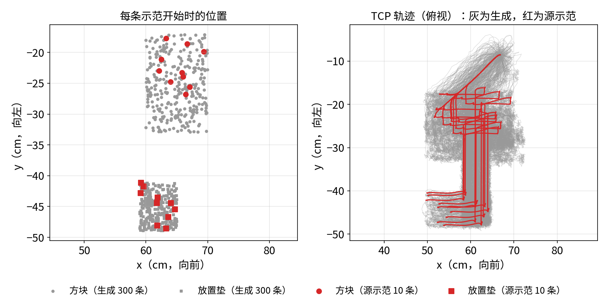
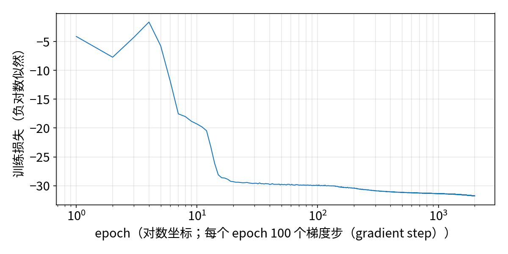

# Mimic 数据生成与模仿学习

:::{admonition} 学习目标
:class: lead-goals

- 用 6.4.6 的 10 条示范走完 Mimic 的四步：标注、生成、训练、评估，知道每一步的产出与代价
- 会让 Isaac Lab 自带的脚本跑自己项目的任务
- 读懂一个没达标的模仿学习结果：先分清失败停在哪一步，再列原因
:::

:::{admonition} 前置知识
:class: lead-prereq

- [4.19 Isaac Lab Mimic 与模仿学习](../../4-isaaclab/4.19-mimic.md)：四步流水线、生成原理、数据格式
- [6.4.6 遥操作采集示教数据](6.4.6-teleop-demos.md)：本页的 10 条源示范与 Mimic 接口
- [5.7 模仿学习与 RL 的选择](../../5-rl/5.7-il-vs-rl.md)
:::

**本页在项目中新增**：`scripts/mimic_pipeline.sh`（四步命令）、`scripts/run_isaaclab_script.py`（让官方脚本认识本项目任务）、`scripts/eval_bc_pick_place.py`（评估并给失败分类）、`scripts/plot_mimic_data.py`（图 1、图 2）；任务包里加了 robomimic 配置 `agents/robomimic/bc_rnn_low_dim.json`。

## 让官方脚本跑本项目的任务

标注、生成、训练、评估用的都是 Isaac Lab 自带的脚本[^scripts]。它们只导入官方任务包，不认识 `Galbot-PickPlace-*`。Isaac Lab 3.0 为此加了 `--external_callback`（4.19 版本说明），2.3.2 没有。本项目的任务模块又必须在 Kit 启动之后才能导入。`run_isaaclab_script.py` 的做法是把 `AppLauncher.__init__` 包一层：Kit 一起来就导入 `galbot_academy.tasks`，然后原样运行官方脚本，脚本本身一行不改。

```bash
ISAACLAB=<Isaac Lab 克隆> NUM_GEN=300 EPOCHS=2000 bash scripts/mimic_pipeline.sh annotate generate train
ISAACLAB=<Isaac Lab 克隆> CKPT=logs/robomimic/.../model_epoch_2000.pth bash scripts/mimic_pipeline.sh play
```

## 四步实测

**子任务怎么分。** 卡片列的是接近、抓取、搬运、放置四段，本页只分两段：以方块为参考、到 `grasp` 信号为止；以放置垫为参考、到示范结束（6.4.6"Mimic 接口"）。Mimic 按段把源示范变换到新的物体位置，变换由这一段的参考物体决定[^transform]。接近与抓取的参考都是方块，搬运与放置的参考都是放置垫，再细分只是多几个切点，变换相同。官方 Franka 堆方块也是一个物体一段[^franka-cfg]。

| 步骤 | 设置 | 结果 | 用时 | 进程显存 / 主机内存 |
|---|---|---|---|---|
| ① 标注 | `--auto`，GPU | 10 / 10 导出 | 4 min 15 s | 2401 MiB / 3.5 GB |
| ② 生成 | CPU，10 环境，`action_noise=0.005` | 300 成功 / 301 次尝试（99.7%） | 7 min 0 s | 239 MiB / 2.0 GB |
| ③ 训练 | BC-RNN，2000 epoch，GPU | 损失 −4.1 → −31.8 | 23 min 48 s | 365 MiB / 整机可用内存降约 2.7 GB |
| ④ 评估 | `play.py`，100 回合，上限 900 步 | **38 / 100** | 58 min | 2485 MiB / 4.0 GB |

*表 1：2026-10-11 实测，RTX 5070；用时含启动。生成文件 99 MB，失败尝试另存 0.39 MB。训练行的内存按整机可用内存（MemAvailable）的降幅计：robomimic 的 4 个读数据子进程共享数据缓存，进程树 RSS 相加（12.2 GB）会重复计数，同 4.19 的处理。*

- **标注**：`--auto` 时子任务边界由环境的 `subtask_terms` 给出，10 条都在同一步切开：标注文件里 `grasp` 第一次为真的下标是 133，比 6.4.6 检查脚本数的第 132 步晚一格，因为标注在每步执行之前记录。不加 `--auto` 就是手动标注：重放时在每段结束处按一次键（4.19 误解三）。标注要在 GPU 上做，见坑一。
- **生成**：99.7% 的成功率远高于 4.19 官方 Franka 的 36.8%。可能的原因是本页只有一个物体要抓，示教手法又完全一致（推断）。
- **训练**：配置照搬官方 Franka stack 的 `bc_rnn_low_dim.json`[^bc-cfg]（两层 LSTM、隐藏维度（hidden dim）400、序列长度（sequence length）10、5 个分量的高斯混合输出，2000 epoch，每 epoch 100 个梯度步（gradient step）），只换观测键。损失是负对数似然，可以为负（4.19）。



*图 1：左，每条示范开始时方块（圆）与放置垫（方）的位置；右，TCP 的俯视轨迹。红为 10 条源示范，灰为 300 条生成数据（`plot_mimic_data.py`，机器人根坐标系）。*

图 1 是"生成数据的可视化"：10 条源示范的方块只落在 y = −27 至 −18 cm，生成数据把重置范围（y 方向 ±8 cm）铺满了。右图的灰线保留了源示范的形状，接近、上抬、沿 −y 搬运、后撤，只是整体平移、加了噪声。生成数据覆盖了更多位置，但手法仍是同一种（4.19 误解二）。



*图 2：训练损失（横轴对数坐标）。前 20 个 epoch 降到约 −29，之后 1980 个 epoch 只再降约 2.8。*

## 评估：38%，没有达到合格线

卡片的合格线是 ≥ 50%，本页的 38 / 100 没有达到。

| 方法 | 任务 | 成功率 |
|---|---|---|
| 脚本化示教控制器（6.4.6） | pick-place | 20 / 20；正式录制 10 / 10 |
| BC-RNN，300 条 Mimic 生成数据（本页） | pick-place | 38 / 100 |
| PPO，基线与 6 组对照（[6.4.3](6.4.3-lift.md)） | 只举起 | 都是 0% |
| 官方 Galbot One Charlie stack Mimic | 堆方块 | 本站未复跑[^galbot] |

*表 2：前三行是同一台 Galbot One Golf、同一套方块与夹爪；lift 只是 pick-place 的前半段。最后一行是官方的 One Charlie，只给链接。*

**失败停在哪。** `play.py` 只报成败。`eval_bc_pick_place.py` 用同一个回合循环、同一个种子跑前 30 回合，逐步记录走到了哪一段。阶段判定沿用 6.4.6 的 `grasp` 信号和成功判定里的"方块中心离垫中心 ≤ 3 cm"。结果是 11 / 30，成功的回合编号与 `play.py` 的前 30 回合逐个相同：

| 最远到达 | 回合数 | 结束原因 |
|---|---|---|
| 没抓住（`grasp` 从未出现） | 0 | — |
| 抓住了，但方块没进过垫中心 3 cm 内 | 16 | 13 次到 900 步上限；3 次方块掉落 |
| 送到了，但没满足成功判定 | 3 | 都到 900 步上限 |
| 成功 | 11 | 用了 460–882 步（源示范 482–640 步） |

*表 3：前 30 回合的失败分类（2026-10-11，用时 17 min 50 s）。第 2 行的 16 次里，有 5 次方块始终没比起始位置高出 3 cm。*

读法：

- **抓取学会了**：30 回合都触发了 `grasp`。卡在后半段：搬运没走到、放下没完成。
- **多数失败不是做错，是没做完**：19 次失败里 16 次是到了 900 步上限：方块没有掉下桌，只是到时间还没完成。成功的回合也比源示范慢，最慢的 882 步。

候选原因（都是推断，本页没有做对照）：

1. **源示范只有一种手法**：10 条都由同一个控制器产生，节奏一致，没有任何"偏了再纠正"的片段（6.4.6 表 4）。策略一旦走偏，数据里没有怎么回来的示范。
2. **示教动作"顶格匀速"**：位置增量大多顶在每轴 1 cm 的限幅上。高斯混合输出采样到较小的增量时，手就走得慢、停在半路。
3. **回合上限偏紧**：两个成功回合用了 827、882 步，离 900 步上限很近。放宽上限可能多救回几回合，但不改变"慢"这件事。

下一步可试：录更多样的源示范（不同速度、带纠正动作），或者按 4.19 加大生成规模后，再与本页单因素对照。

## 常见坑

### 坑一：标注换到 CPU，10 条全部失败

4.19 的官方示例统一用 `--device cpu`。照做的结果是 0 / 10 导出（45 s），换回 GPU 是 10 / 10。标注是开环重放录下的动作，6.4.6 的示范录在 GPU 上，换了设备，物理结果就不同（4.19 误解四）。6.4.6 的示范对位置很敏感（示教时 approach 段要停到 0.6 cm 内才合拢），换设备的偏差可能让重放没能完成任务。标注日志对 10 条都只报"The final task was not completed."：自动模式要等最终任务完成才检查子任务信号[^annotate]，所以看不出是抓空还是没放成（推断，没有逐步比较两种设备的轨迹）。生成不受影响：它每步按当前末端位姿重新算动作，不是开环重放，在 CPU 上 99.7%。

### 坑二：`action_noise` 要和动作的大小比

`action_noise` 是生成时加在每步动作上的高斯噪声标准差。官方 Franka 配置是 0.03[^franka-cfg]，官方 Galbot 是 0.01[^galbot]。本页先照 Franka 用 0.03：10 分钟里 494 次尝试 0 次成功。改成 0.005、其余不变（同一个标注文件、10 环境、CPU）：20 s 生成 10 / 10。本项目的示教动作每轴每步最多 1 cm（6.4.6），0.03 的噪声是动作本身的 3 倍。`generation_guarantee=True`（默认值，本页也是）时，凑不够成功条数 `generate_dataset.py` 会一直尝试下去，不会自己停。配置里的 `max_num_failures` 在 2.3.2 的生成代码中没有被读取，不起作用（上面 494 次失败也没停）。

另外，在 CPU 上标注、生成时，日志里会刷出大量 `[Error] PhysX error: ... Body must be non-kinematic!`（`gen300` 有 1284 行，GPU 上没有）。来源是重置事件给运动学的放置垫写速度。CPU 生成在这些报错下仍有 99.7%，可以忽略。

### 坑三：官方脚本对自己任务的几处假设

- **1 维观测被 squeeze 成标量**：`play.py` 对每项观测做 `torch.squeeze`[^play]，1 维的 `gripper_pos` 变成 0 维，robomimic 报 `AssertionError`。本页的 BC 观测改用 `joint_pos`（已含夹爪关节）。
- **实验目录已存在时等键盘输入**：robomimic 在 stdin 上问 "overwrite? (y/n)"[^overwrite]，非交互运行直接 `EOFError`。`mimic_pipeline.sh` 每次训练用带时间戳的 `--name`。
- **夹爪动作的形状**：基类文档写 `actions_to_gripper_actions` 收到 (环境数, 步数, 7)[^env]，生成器实际传入一条示范的 (步数, 7)[^pool]。按最后一维取 `actions[..., -1:]`，两种都对。

## 延伸阅读

- MimicGen 论文与更多任务：见 4.19 延伸阅读
- robomimic 0.4 的算法与配置 <https://robomimic.github.io/docs/v0.4/introduction/overview.html>

## 版本说明

本页基于 Isaac Sim 5.1.0、Isaac Lab 2.3.2 与 robomimic 0.4.0。Isaac Lab 3.0 的标注、生成脚本可用 `--external_callback` 导入外部任务（4.19 版本说明），这两步可以不用 `run_isaaclab_script.py`；v3.0.0 的 `robomimic/train.py`、`play.py` 仍没有这个参数，仍需要它[^v30]。其余未核对，见 [8.1 3.0 改了什么、为什么改](../../8-frontier/8.1-what-changed.md)。

3.0 的差异以 [8.6 版本追踪](../../8-frontier/8.6-version-tracking.md) 为准，本页最后核对的版本见该页核对状态表。

[^scripts]: Isaac Lab tag v2.3.2：`scripts/imitation_learning/`（`isaaclab_mimic/annotate_demos.py`、`isaaclab_mimic/generate_dataset.py`、`robomimic/train.py`、`robomimic/play.py`）<https://github.com/isaac-sim/IsaacLab/tree/v2.3.2/scripts/imitation_learning>
[^transform]: `isaaclab_mimic/datagen/data_generator.py`（tag v2.3.2）`transform_source_data_segment_using_object_pose` L57–L89 <https://github.com/isaac-sim/IsaacLab/blob/v2.3.2/source/isaaclab_mimic/isaaclab_mimic/datagen/data_generator.py#L57-L89>
[^franka-cfg]: `isaaclab_mimic/envs/franka_stack_ik_rel_mimic_env_cfg.py`（tag v2.3.2）：四段子任务，`action_noise=0.03`（L54 等）<https://github.com/isaac-sim/IsaacLab/blob/v2.3.2/source/isaaclab_mimic/isaaclab_mimic/envs/franka_stack_ik_rel_mimic_env_cfg.py#L54>
[^galbot]: `isaaclab_mimic/envs/galbot_stack_rmp_rel_mimic_env_cfg.py`（tag v2.3.2）：`action_noise=0.01`（L57 等）<https://github.com/isaac-sim/IsaacLab/blob/v2.3.2/source/isaaclab_mimic/isaaclab_mimic/envs/galbot_stack_rmp_rel_mimic_env_cfg.py#L57>；环境注册 `isaaclab_mimic/envs/__init__.py` L86–L137
[^bc-cfg]: `isaaclab_tasks/manager_based/manipulation/stack/config/franka/agents/robomimic/bc_rnn_low_dim.json`（tag v2.3.2）<https://github.com/isaac-sim/IsaacLab/blob/v2.3.2/source/isaaclab_tasks/isaaclab_tasks/manager_based/manipulation/stack/config/franka/agents/robomimic/bc_rnn_low_dim.json>
[^annotate]: `scripts/imitation_learning/isaaclab_mimic/annotate_demos.py`（tag v2.3.2）L405–L413：最终任务完成后才检查子任务信号 <https://github.com/isaac-sim/IsaacLab/blob/v2.3.2/scripts/imitation_learning/isaaclab_mimic/annotate_demos.py#L405-L413>
[^play]: `scripts/imitation_learning/robomimic/play.py`（tag v2.3.2）L100 <https://github.com/isaac-sim/IsaacLab/blob/v2.3.2/scripts/imitation_learning/robomimic/play.py#L100>
[^overwrite]: robomimic tag v0.4.0 `robomimic/utils/train_utils.py` L58–L62 <https://github.com/ARISE-Initiative/robomimic/blob/v0.4.0/robomimic/utils/train_utils.py#L58-L62>
[^env]: `isaaclab/envs/manager_based_rl_mimic_env.py`（tag v2.3.2）L94–L103 <https://github.com/isaac-sim/IsaacLab/blob/v2.3.2/source/isaaclab/isaaclab/envs/manager_based_rl_mimic_env.py#L94-L103>
[^v30]: Isaac Lab tag v3.0.0 `scripts/imitation_learning/robomimic/`（`train.py`、`play.py` 中没有 `external_callback`，本站 2026-10-24 核对）<https://github.com/isaac-sim/IsaacLab/tree/v3.0.0/scripts/imitation_learning/robomimic>
[^pool]: `isaaclab_mimic/datagen/datagen_info_pool.py`（tag v2.3.2）L114 <https://github.com/isaac-sim/IsaacLab/blob/v2.3.2/source/isaaclab_mimic/isaaclab_mimic/datagen/datagen_info_pool.py#L114>
