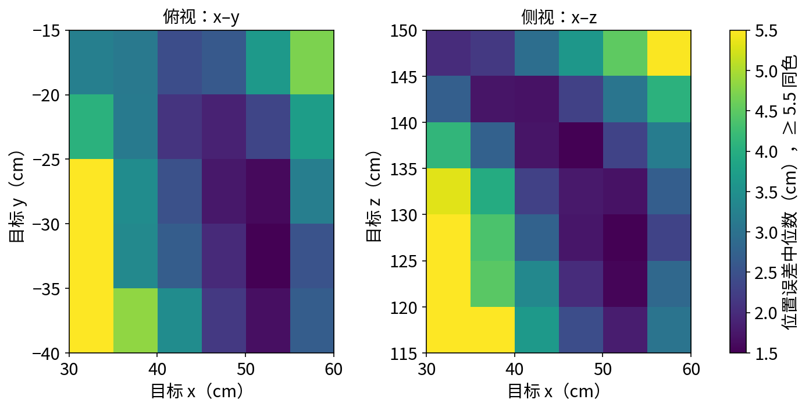

# 定量评估与失败案例分析

:::{admonition} 学习目标
:class: lead-goals

- 给一个成功率配上区间，判断"两次评估差 2 个点"算不算差异
- 把评估结果按条件切开，找出策略在哪里好、在哪里差
- 给失败样本分类，并让分类由脚本自动完成
- 把"在什么分布上评估"当成结论的一部分写出来
:::

:::{admonition} 前置知识
:class: lead-prereq

- [6.6.1 play 脚本与策略回放](6.6.1-play-replay.md)：最基本的定量评估（中位数与分位数）
- [6.5.1 训练 reach](../5-train/6.5.1-train-reach-rsl-rl.md)：被评估的 reach 策略
- [6.4.7 Mimic 数据生成与模仿学习](../4-task/6.4.7-mimic.md)：被评估的 pick-place BC 策略与它的失败分类
:::

**本页在项目中新增**：`scripts/eval_report.py`（读逐样本 CSV 出表与图，不需要 Isaac Sim）；`eval_reach.py` 加了 `--csv` 与 `--widen_targets`，`eval_bc_pick_place.py` 加了 `--csv`，原有打印不变。

两个策略用同一套方法：reach（6.5.1，2026-10-10 重训的 seed-42 `model_999.pt`），已经达标；pick-place BC（6.4.7，`model_epoch_2000.pth`），没有达标。

## 逐样本 CSV

先把每个样本写下来，再离线统计。这样换统计口径时不用重跑仿真。

| 文件 | 一行是 | 列 |
|---|---|---|
| `eval_reach.py --csv` | 一段目标的末尾 | `seed`、`task`、`widen`、`env`、`segment`（1–3）、`target_x/y/z`（目标位置，根坐标系，m）、`pos_err`（m）、`rot_err`（rad）、`moved`（该段最后 0.5 s 右臂关节位置的最大变化，rad） |
| `eval_bc_pick_place.py --csv` | 一个回合 | `seed`、`episode`、`stage`（0–3）、`stage_name`、`end`、`steps`、`lifted`、`object_x/y`（方块起点）、`target_x/y`（放置垫） |

*表 1：CSV 的列（脚本头注释里有同样的说明）。*

记录目标时有一处细节：命令项每步先算误差、再按时间重采样目标[^cmd]。所以一段的最后一步，误差对应的是**重采样之前**的目标；脚本在 `env.step()` 之前存下目标。

## 这个数有多可信

成功率是一个比例。只评估 $n$ 个样本时，它本身就有抽样误差（sampling error），要配一个置信区间（confidence interval）来读。本页用 Wilson 区间（Wilson score interval）表示：

$$
\frac{\hat p + \frac{z^2}{2n}}{1 + \frac{z^2}{n}} \pm \frac{z}{1 + \frac{z^2}{n}} \sqrt{\frac{\hat p (1 - \hat p)}{n} + \frac{z^2}{4n^2}}
$$

其中 $\hat p$ 是观测到的成功率，$n$ 是样本数，$z = 1.96$ 对应 95% 的置信水平（confidence level）。$n$ 小或 $\hat p$ 靠近 0、1 时，它比常见的 $\hat p \pm z\sqrt{\hat p(1-\hat p)/n}$ 可靠。

| 样本数 N | 成功率约 80% 时 | 成功率约 40% 时 |
|---|---|---|
| 30 | ±13.9 | ±16.5 |
| 100 | ±7.8 | ±9.4 |
| 300 | ±4.5 | ±5.5 |
| 1000 | ±2.5 | ±3.0 |

*表 2：95% 区间的半宽（百分点）。*

reach 一次评估有 768 个样本，"< 5 cm"的区间约 ±2.8 个百分点；BC 评估 100 回合，38% 的区间是 29.1–47.8%。也就是说，BC 的真实成功率在三成上下都有可能。

再看换评估种子（目标与初始姿态的随机序列不同）：

| 评估种子 | 中位数 | < 2 cm | < 5 cm |
|---|---|---|---|
| 0 | 2.73 cm | 32.2%（29.0–35.5） | 80.9%（77.9–83.5） |
| 1 | 2.92 cm | 28.8%（25.7–32.1） | 81.0%（78.1–83.6） |
| 2 | 2.99 cm | 29.3%（26.2–32.6） | 82.0%（79.2–84.6） |

*表 3：同一检查点、3 个评估种子，各 256 个环境 × 3 段 = 768 个样本（2026-10-11 实测，每次约 30 s）。括号内是 Wilson 区间。*

三个种子的"< 5 cm"相差 1.1 个百分点，都在彼此的区间里。所以对 reach 来说，两次评估差 2 个点不算差异。一个细节：同一个环境里的 3 段目标不完全独立（同一台机器人、接着上一段的姿态），实际的区间还要宽一些（推断）。

## 在哪里好、在哪里差

把 3 个种子的 2304 个样本合起来，按目标位置和段序号切片（slicing，即按条件把样本分组统计；与张量的索引切片无关）。分界取各轴采样范围的中点。

| 切片 | N | 中位数 | < 5 cm |
|---|---|---|---|
| 近（x < 45 cm） / 远 | 1166 / 1138 | 3.45 / 2.49 cm | 71.9% / 90.9% |
| 低（z < 132.5 cm） / 高 | 1171 / 1133 | 2.95 / 2.80 cm | 76.8% / 86.0% |
| 偏右（y < −27.5 cm） / 偏左 | 1142 / 1162 | 2.80 / 2.96 cm | 79.1% / 83.5% |
| 第 1 / 2 / 3 段 | 各 768 | 2.85 / 2.90 / 2.88 cm | 83.2% / 80.2% / 80.5% |

*表 4：reach 按条件切片。*

*图 1：位置误差中位数随目标位置的分布（左：俯视 x–y；右：侧视 x–z；每格至少 10 个样本，3 个种子合并）。颜色越亮误差越大，≥ 5.5 cm 都画成同一种黄色。*

- **差在近处**：以 x = 45 cm 为界，近的一半与远的一半"< 5 cm"相差 19 个百分点，区间不重叠。最差的是离身体最近的一列（x 30–35 cm），尤其是同时偏低或偏右时。远处偏高的一角（x 55–60 cm、z 145–150 cm）也偏差。这两处都在训练采样范围的边缘。6.2.1 按体素密度定的可达范围是 x ≥ 25 cm，只看位置、没考虑姿态；近处要把手臂折回来，又要保持指定姿态，关节可能顶到限位（推断，没有检查关节余量）。
- **与段序号无关**：三段的差别在区间之内。说明"从上一段的姿态出发"并没有让后面的段变难。

## 失败样本归类

reach 把"误差 ≥ 5 cm"算失败，再用 CSV 里的 `moved` 与 `rot_err` 自动归类：

| 类别 | 判据 | 样本数（共 2304） |
|---|---|---|
| 停住没到 | 失败，且最后 0.5 s 关节变化 < 0.01 rad | 15 |
| 还在动 | 失败，且最后 0.5 s 关节变化 ≥ 0.01 rad | 416 |
| 　其中姿态已对 | 上两类中姿态误差 < 0.1 rad | 231 |
| 位置到了、姿态没到 | 误差 < 5 cm，姿态误差 ≥ 0.1 rad | 241 |

*表 5：reach 的失败模式（`eval_report.py`）。*

- **"还在动"占失败的绝大多数**：每段只有 4 s，到时还在往目标走。误差最大的一个（种子 0、环境 234、第 2 段）的目标在 (0.307, −0.390, 1.181) m，正是图 1 最差的那个角，最后 0.5 s 关节还动了 0.043 rad。这类失败多半是"慢"，不是"到不了"（推断：没有延长每段时间做对照）。
- **"停住没到"只有 15 个**：6.5.1 把刚度从 400 提到 1600 之前，约一半的目标会停在离目标约 5 cm 处；现在这类样本已经很少。剩下的目标平均更靠近身体（x 均值 36.5 cm，全体是 44.9 cm），与图 1 一致。误差最大的一个（种子 0、环境 152、第 1 段）的目标在 (0.312, −0.393, 1.210) m，最后 0.5 s 关节只动了 0.004 rad，误差停在 10.8 cm。

## pick-place BC：同一套方法用在没达标的策略上

`eval_bc_pick_place.py --csv` 用 6.4.7 的检查点与种子重跑 100 回合（58 分钟）。结果 38 / 100，与 6.4.7 的 `play.py` 逐回合相同。失败沿用 6.4.7 的阶段分类：

| 最远到达 | 回合数 | 结束原因 |
|---|---|---|
| 没抓住 | 1 | 到 900 步上限 |
| 抓住了，但方块没进过垫中心 3 cm 内 | 53 | 40 次到上限，13 次掉落；其中 36 次举起过 3 cm 以上 |
| 送到了，但没满足成功判定 | 8 | 7 次到上限，1 次掉落 |
| 成功 | 38 | — |

*表 6：BC 的失败分类（100 回合）。*

与 6.4.7 的 30 回合诊断相比，比例几乎一样：抓取学会了，卡在搬运与放置；多数失败是到时间还没做完。两个例子：

- 第 0 回合：抓住、举起，搬到第 707 步时方块掉下桌面；
- 第 5 回合：方块已到垫上方 3 cm 内，但到 900 步也没满足"放下、松手、后撤"。

**按方块起点切片**：6.4.7 图 1 显示，10 条源示范的方块起点只覆盖 y = −26.8 至 −17.7 cm，生成数据却铺满了 ±8 cm 的重置范围。用 `--bc_source` 把评估回合按"起点在不在源示范覆盖的 y 范围内"分开：

| 方块起点 | N | 成功率 |
|---|---|---|
| 在源示范覆盖的 y 范围内 | 57 | 47.4%（35.0–60.1） |
| 在范围外 | 43 | 25.6%（14.9–40.2） |

*表 7：BC 按方块起点切片。按 x、按方块到垫的距离切片，两半的差都在区间之内。*

这与 6.4.7 的候选原因一"源示范只有一种手法"方向一致：离源示范远的起点更难。但两个区间仍有重叠，100 回合不足以下结论。要确认，需要更多回合，或者补一批覆盖那一侧的源示范再对照。

## 评估分布要写进结论

评估分布（evaluation distribution）指评估时目标、初始状态与物理参数从什么范围里采样。同一个 reach 检查点，换三种评估条件（种子 0）：

| 评估条件 | 中位数 | 90% 分位 | < 5 cm |
|---|---|---|---|
| 与训练相同（`Galbot-Reach-Play-v0`） | 2.73 cm | 6.31 cm | 80.9%（77.9–83.5） |
| 开域随机化（`Galbot-Reach-DR-v0`，6.4.2 表 1 的随机化项：质量、增益、armature、初始速度、观测噪声） | 2.95 cm | 6.37 cm | 80.3%（77.4–83.0） |
| 目标范围各向外扩 5 cm（`--widen_targets 0.05`） | 3.92 cm | 8.79 cm | 63.3%（59.8–66.6） |

*表 8：评估分布对照（2026-10-11 实测）。外扩那一行中，落在训练范围内的 337 个样本 < 5 cm 为 86.4%，范围外的 431 个只有 45.2%。*

这个策略没有用域随机化训练，但对 6.4.2 那几项扰动并不敏感。真正拉低结果的是目标超出训练范围。所以"成功率 81%"必须带上条件："在训练时的目标范围内、不加随机化"。换一个评估分布，同一个策略可以是 63%。

## 阈值敏感性

| 成功阈值 | 2 cm | 3 cm | 5 cm | 8 cm |
|---|---|---|---|---|
| reach 成功率（2304 个样本） | 30.1% | 52.4% | 81.3% | 96.6% |

*表 9：同一批样本在不同阈值下的成功率。*

阈值从 2 cm 放到 8 cm，成功率从三成变成九成多。所以阈值要先由任务定：抓取一个 5 cm 的方块，夹爪能容忍多少偏差？再拿结果去对照，而不是看哪个阈值好看就报哪个。本站 reach 的合格线是 6.5.1 定的"中位数 ≤ 3 cm，且 < 5 cm 的比例 ≥ 80%"。

## 常见坑

### 坑一：拿均值当指标

reach 种子 0 的均值是 3.29 cm，中位数是 2.73 cm。少数大误差（最大 11.3 cm）会把均值拉高，而这些样本已经由"失败"一栏单独计数了。指标用中位数、分位数和成功率（6.6.1）。

### 坑二：样本少就比较两个策略

N = 30 时，成功率的区间约 ±14–17 个百分点（表 2）。6.4.7 的诊断只跑了 30 回合（11 / 30），它只能说明"大约三成"，不能用来和 38 / 100 比高低。比较两个策略之前，先看两边的区间是否分开。

### 坑三：只用一个评估种子

一个种子给出的是一次抽样（表 3）。改动带来的提升如果小于种子间的波动，就要多跑几个种子再下结论。

### 坑四：评估分布和训练分布不一致却不写

表 8 中，目标范围只外扩 5 cm，成功率就从 81% 掉到 63%。读别人的数字时先问评估条件；报自己的数字时把条件写全。评估条件也包括提前终止的回合怎么算：6.4.5 的第一版评估脚本把倾覆后被重置的回合也算成了成功，见 [6.4.5 坑七](../4-task/6.4.5-base-navigation.md#坑七评估里倾覆的回合照样算成功)。

## 延伸阅读

- Wilson 区间的原始论文：E. B. Wilson, *Probable Inference, the Law of Succession, and Statistical Inference*, JASA 22 (1927)
- 评估之后怎么部署：[6.7.1 策略导出](../7-deploy/6.7.1-policy-export.md)

## 版本说明

本页基于 Isaac Lab 2.3.2。评估方法与版本无关；3.0 中脚本与命令项的情况未核对，见 [8.1 3.0 改了什么、为什么改](../../8-frontier/8.1-what-changed.md)。

3.0 的差异以 [8.6 版本追踪](../../8-frontier/8.6-version-tracking.md) 为准，本页最后核对的版本见该页核对状态表。

[^cmd]: Isaac Lab `managers/command_manager.py`（tag v2.3.2）`CommandTerm.compute` L152–L167：先 `_update_metrics`，再减少剩余时间、到时重采样 <https://github.com/isaac-sim/IsaacLab/blob/v2.3.2/source/isaaclab/isaaclab/managers/command_manager.py#L152-L167>
